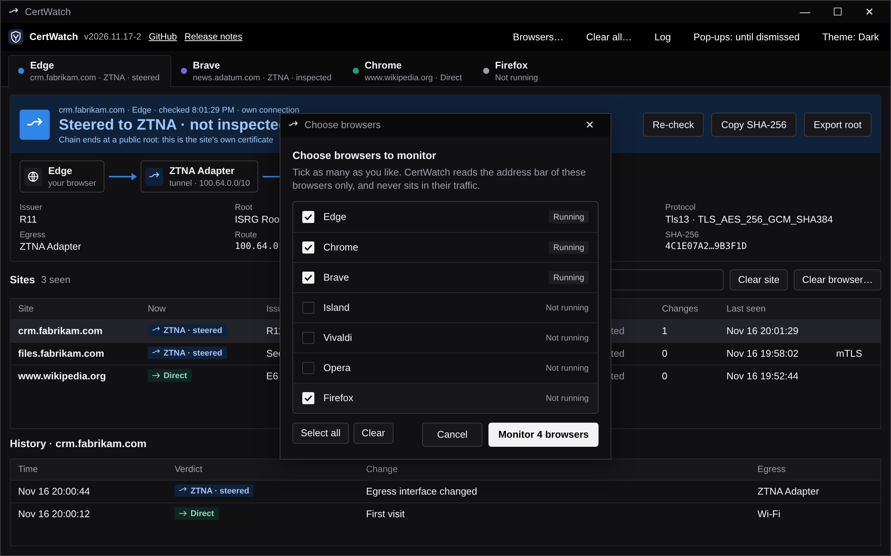
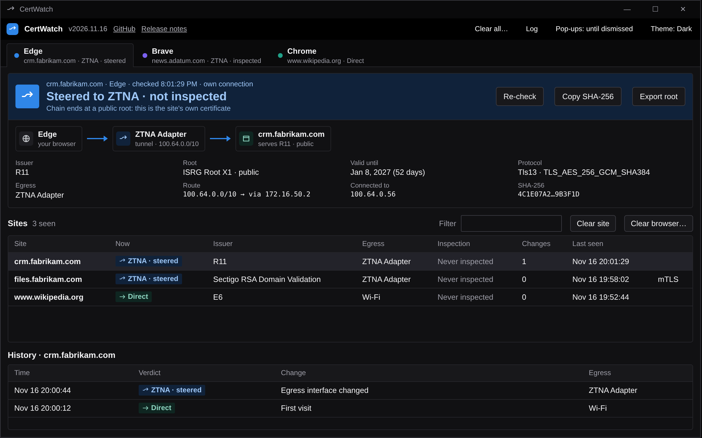
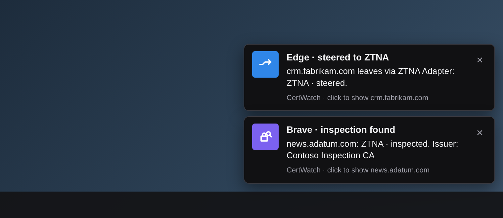
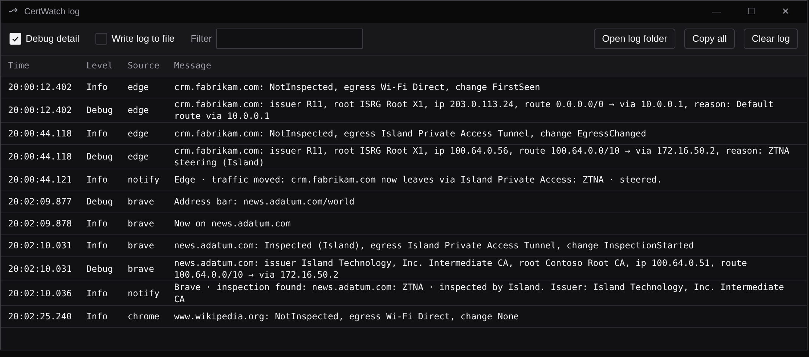

# CertWatch


**[GitHub](https://github.com/darthrater78/certwatch)** · **[Release notes for v2026.11.17-2](https://github.com/darthrater78/certwatch/releases/tag/v2026.11.17-2)** · [Changelog](CHANGELOG.md)

A Windows app for ZTNA demos. For each browser you choose to monitor, it shows, live, whether the
site in the active tab is **steered into the ZTNA tunnel** and whether its certificate was
**replaced for inspection**, with the path drawn out (browser → tunnel or direct → inspection →
site). It calls out changes in pop-ups, flags mTLS sites, and keeps an encrypted per-site history.

## How it works: it watches, it never intercepts

> [!IMPORTANT]
> **CertWatch is not in the browser's path.** It never proxies, intercepts, decrypts or alters
> traffic, and connections never pass through it. It reads handshakes only if you start CertWatch as
> administrator and turn on **Read this process's handshakes** in **Process flow**; that reads the
> cleartext TLS handshake of the process you chose (or of every process, if you chose **All
> processes**), in memory, and nothing else.

What CertWatch actually does, in order:

1. **You choose which browsers to monitor.** Nothing is read until you pick browsers (CertWatch
   asks on first run; change it later with **Browsers…**). Browsers you didn't pick are never read.
2. **It reads the address bar.** For each ticked browser it reads the address shown in the active
   tab, through Windows UI Automation, the accessibility interface screen readers use. It only reads
   the text. It never types into, clicks or controls the browser, and needs no extension.
3. **It keeps only the host and port.** `https://portal.contoso.com/login?token=…` becomes
   `portal.contoso.com:443`. The path and query string are dropped before anything is checked,
   saved or logged. Non-HTTPS pages (`edge://`, `about:`, plain `http`) are ignored.
4. **It makes its own, separate connection to that host.** It starts a TLS handshake from
   CertWatch itself (through the system proxy if one is set), records the certificate the network
   hands back, and closes the connection. It sends no request, no cookies and no client
   certificate. It repeats this when the site changes and every 15 seconds after that.
5. **It works out the verdict.** The certificate chain says whether the site's own certificate
   arrived (public root) or a replacement did (a private root this PC trusts means inspection).
   Windows' routing table says which adapter the traffic leaves by: the ZTNA tunnel or the normal
   network.

**What it doesn't see.** Because it reads the address bar rather than the network, CertWatch knows
only the site in the active tab of each monitored browser. It doesn't see other tabs, the other
hosts a page loads from (CDNs, APIs, iframes), DNS lookups, or anything that never appears in the
address bar. If `portal.contoso.com` pulls data from `api.contoso.net`, only the portal is checked.

**Its view can differ from the browser's.** The verdict describes CertWatch's own connection, not
the browser's. Both normally take the same path (same adapter, same proxy), so they match. They can
differ when a ZTNA product treats traffic per browser rather than per device. An enterprise browser
with ZTNA built in is the main example: its in-browser path may be inspected or steered in a way a
separate connection from another app doesn't see. CertWatch now notices this case (see
[When the browser takes its own path](#when-the-browser-takes-its-own-path)).

**What it never does.** It listens on no network port, installs no certificate, changes no proxy,
PAC, route or registry setting, injects nothing into any process, hooks no keyboard input, and never
starts or drives a browser. The details, checkable against the code, are under
[Security architecture](#security-architecture).

## Process flow

**Process flow…** in the header targets a process and lists where it connects, with the path and
certificate chain for each destination. Pick **All processes**, pick one with open connections, or type its name under
**Add by name** (`java` or `app.exe`). A named process doesn't need to be running yet, so you can
press **Start** first and catch its first handshakes when it launches. If different programs share
that name, each exe gets its own rows. Added names last until the
window closes. **Clear list** empties the results and their accepted and refused counts; connections
still open reappear. Every row says how it knows what it shows:

| | Without admin (default) | Started as administrator, handshake reading on |
|---|---|---|
| **Connections** | Windows' connection table | The same |
| **Host name** | **Inferred** from reverse DNS, which can be wrong on shared addresses | **Observed** in the process's ClientHello, for connections opened after you turn it on (IPv4) |
| **TLS 1.2 certificate** | CertWatch's own handshake | The certificate the process actually received |
| **TLS 1.3 certificate** | CertWatch's own handshake | CertWatch's own handshake to the same address and host, because TLS 1.3 encrypts it |

If a process received a different certificate from the one CertWatch's own handshake got, the row
reads **Different cert**. With handshake reading on, **Process response** counts the connections it
accepted and refused, and repeated refusal of a trusted inspected certificate reads **Pinning
likely** (see [How it decides](#how-it-decides)). CertWatch's own handshakes go only to routable addresses on ports 443 and
8443, or a port where a real TLS handshake was seen, so non-TLS services aren't contacted.
QUIC/HTTP/3 runs over UDP and isn't listed. Results stay in memory and aren't added to history.

Many servers host several sites and won't send a certificate until told which one is wanted. For a
connection whose hostname CertWatch didn't see, it tries the hostnames that same app used elsewhere
and keeps one only if the certificate is valid for it, labelled **Inferred**. If none fits, the row
reads **Needs hostname**: the server has a certificate, and a new connection from the app will
reveal which name to ask for.

**All processes** gives each app its own row per destination, so one app's result can't hide
another's, and leaves out local (loopback) connections. CertWatch then makes its own handshakes to
the TLS destinations of every app on this PC, and with handshake reading on it reads every app's
handshakes, so use it when that's what you want to show. The list holds up to 256 rows.

### How to tell if a process is pinned

Pinning only shows when an app is handed a replaced certificate, so the destination must be
inspected for the test to mean anything.

1. Start CertWatch as administrator, open **Process flow…**, and choose or add the app.
2. Press **Start**, turn on **Read this process's handshakes**, then restart the app and use the
   feature that fails.
3. Read the **Pinned?** column, or select a row for the reason and the next step.

| Pinned? | Meaning | What to do |
|---|---|---|
| **Pinning likely** | Refused a trusted inspected certificate 3 or more times and never accepted it | Add an inspection bypass and retest. If it now connects, inspection was what broke it |
| **Refused 1 of 3** | Refused it, but not enough times to call | Use the feature again so it retries |
| **No sign** | Completed a connection while the destination was inspected | Nothing |
| **Can't tell** | The test hasn't happened: not inspected, this PC doesn't trust the root, or handshakes aren't being read | Follow the next step shown for that row |
| **Waiting** | Inspected, with no new connection seen yet | Restart the app |

The bypass retest is the strongest evidence CertWatch can point you to, but it still doesn't separate
pinning from an app's private trust store. To tell those apart, add the inspection root to the app's
own trust store: an app that then connects wasn't pinned.

## Screenshots

These are illustrations drawn from the app's own theme colours and layout, with invented example
data (Contoso, Fabrikam and Adatum are fictitious names), not captures of a real session. They are
drawn by `tools/gen_mockups.py` (see [Build](#build-linux-or-windows)).

**Choosing browsers.** On first run, and from **Browsers…** in the header, CertWatch asks which
browsers to monitor. Tick as many as you like; nothing changes until you press **Monitor**. Every
chosen browser gets a tab: here Firefox was chosen but isn't running, so its tab says so.



**Steered to ZTNA, not inspected (Dark).** Edge on `crm.fabrikam.com`: traffic leaves through the
ZTNA adapter's tunnel, and the chain ends at a public root, so the certificate is the site's
own. The path reads Edge → ZTNA Adapter → site, and the facts show the route and the IP
actually connected to.



**Steered and inspected (Flashbang).** Brave on `news.adatum.com`: the certificate was replaced by
an inspection CA chaining to a private root this PC trusts, so the card turns violet and adds the
inspection step to the path. (When CertWatch recognises the inspecting vendor, it names it.)


**Pop-ups.** CertWatch's own cards in the corner of the screen when a site is steered, inspection
is found, or traffic moves. Do not disturb doesn't hide them, so the audience sees them during a
screen share.



**History of a site.** Clicking a history entry shows that saved result on the card. Here
`crm.fabrikam.com` was first seen direct over Wi-Fi, then moved into the tunnel when the ZTNA policy
changed. **Back to live** returns to the current result.


**The log.** Every check, change and pop-up, with **Debug detail** for address-bar reads (the
host checked, never the full address), routes and issuers.



## Run (on Windows)

Run `CertWatch.exe`. Only one copy runs; starting it again brings the window forward. On first run
it monitors nothing and asks which browsers to watch: tick as many as you like (Edge, Chrome, Brave,
Vivaldi, Opera, Firefox and others) and press **Monitor**. Change it any time with **Browsers…** in the
header. Your choice is saved. Each chosen browser gets a tab straight away, running or not (a closed
browser's tab says **Not running** and still shows its history), and each follows its own browser,
even in the background. Dropping a browser in
**Browsers…** stops reading its address bar right away and removes its tab. Its history is kept and
comes back if you pick it again. Browsers you didn't pick are never read. Each tab header shows that
browser's current site and verdict.

In a tab:

- **The card** shows the live verdict for the active site: the path diagram, issuer, root, validity,
  protocol, egress adapter, route, the IP CertWatch connected to, and the SHA-256 fingerprint.
  **Re-check**, **Copy SHA-256** and **Export root…** (the root as `.cer`/`.pem`, or the full chain)
  are on it.
- **Sites** lists every site seen in that browser once, with its current label, issuer, egress, and
  whether it was **inspected earlier** even if it isn't now. Filter it by name.
- **History** shows the selected site's first visit and every change. **Click a site or a history
  entry** to show that saved result on the card; **Back to live** returns.
- **Clear site** clears one site for that browser; **Clear browser…** clears all of that browser's
  history.

In the header: **GitHub** and **Release notes** links, **Browsers…** (which browsers to monitor),
**Clear all…** (every browser's history and the log), **Log**, **Pop-ups** (how long pop-ups stay) and **Theme** (Flashbang, the bright theme,
or Dark; the first run matches Windows). The **Log** window has **Debug detail**
(address-bar reads as the host checked, never the full address; routes and issuers) and **Write log to file** (off by default), plus Open log
folder, Copy all and Clear log.

**Dock** (in the header) keeps CertWatch beside the browser instead of in its own window:

- **Right of the browser** or **Left of the browser**: a 380px panel with the card, stacked for the
  narrow width, and under **Sites** the page in focus. Tick **Show all sites** to list every site
  that browser visited (most recent first; click one to show its saved result).
- **Above the browser**: a 64px strip with the status tile, verdict, path and as many facts as fit.
- **Floating window**: the full window, back where you left it.

Pick what it's docked to:

- **The browser window** (moves with it): CertWatch follows the browser window as you move or resize
  it, and hides while the browser is minimised. If the browser is maximised there's no room beside it,
  so CertWatch covers its edge and says so; make the browser smaller or use the screen edge instead.
- **The screen edge** (reserves space): CertWatch takes a strip of the screen the way the taskbar
  does, and Windows fits maximised windows, including the browser, into the rest. It stays on top
  except while a full-screen app is showing. Each time the strip is reserved, Windows resizes every
  maximised window, so CertWatch keeps a tight budget on it: if the strip keeps re-placing itself, it
  gives the edge back, docks to the browser window on the same side, says why, and leaves screen-edge
  docking off until you restart CertWatch. If CertWatch didn't close cleanly while it held the edge
  (a crash, a freeze, a power cut), the next start docks to the browser window instead; choose the
  screen edge from **Dock** to use it again.

Pop-ups are off while CertWatch is docked, since the verdict is already on screen beside the
browser; they're still written to the log, and come back when you float the window again.
**Follow whichever browser is active** (on by default) switches to the tab of the monitored browser
you clicked into, so the docked view always shows the page you're on. **Keep on top** keeps the window
above others. Docked, the compact header has the browser name (pick which browser to show), **Dock**,
and **⋯** for Browsers…, Clear all…, Log, Theme, GitHub and Release notes. The side panel's
footer has the version and both links. CertWatch only ever moves its own window: it never moves,
resizes or brings forward a browser window.

Closing the window keeps CertWatch in the tray (the icon takes the latest verdict's colour); exit
from the tray menu, which also has **Show test pop-up**.

Pop-ups are CertWatch's own small cards in the bottom-right corner, not Windows notifications, so
Do not disturb (which Windows often turns on while you share your screen) doesn't hide them. By
default they stay until you dismiss them (✕) or click them; a click opens CertWatch on that
browser's tab with the site selected, so its card and history are right there. **Pop-ups** in the
header switches between until dismissed, 10 s, 30 s and 1 min; a timed pop-up waits while the mouse
is over it.

Optional command-line switches:

```
CertWatch.exe --browser brave                   # monitor Brave this run (not saved), tab shown before it starts
CertWatch.exe --process SomeBrowser.exe         # add a tab for a browser not in the built-in list
CertWatch.exe --interval 10                     # re-check each current site every 10 s (default 15)
```

## How it decides

Two independent measurements, combined into one label per site:

- **Inspection:** if the certificate chains to a public root (Mozilla bundle, matched by key so
  cross-signed roots count) or is publicly logged (Certificate Transparency), it's the site's own:
  **not inspected**. If it chains to a private root this machine trusts, a proxy replaced it:
  **inspected** (vendor named when recognised).
- **Steering (egress):** Windows is asked which route and interface reach the site's IP. A /32 host
  route with no gateway, a specific route through a gateway on an adapter that has no default
  gateway (how some ZTNA clients do it), a tunnel interface, or a known ZTNA/VPN adapter means
  **tunnelled to ZTNA**; otherwise **direct**. The adapter's friendly name is shown.

Labels: **Steered to ZTNA · inspected**, **Steered to ZTNA · not inspected**, **Inspected on this
device** (certificate replaced, traffic not tunnelled), **Direct · not inspected**. Sites inspected
earlier stay marked "Was inspected". Servers that ask for a client certificate are flagged **mTLS**;
a steered mTLS site that isn't inspected reads **Steered to ZTNA · not inspected (mTLS: needs
bypass)**, because an inspecting proxy can't present your client certificate. Servers that ask for
one only later in the connection (TLS 1.3 post-handshake authentication) aren't detected.

**Certificate pinning is identified by behaviour, in Process flow only.** Pinning is a check inside
the client, not something a server shows, so CertWatch's own connection can't see it. In browsers it
doesn't block inspection: dynamic pinning (HPKP) was removed in 2018, and Chrome and Edge skip their
built-in pins for certificates from a locally installed root, which is what inspecting proxies use.
A browser site that isn't inspected is bypassed by a rule, not by pinning. For desktop apps, turn on
handshake reading in [Process flow](#process-flow): a row reads **Pinning likely** when the process
refused an inspected certificate this PC trusts at least 3 times and never accepted one at that
destination. A refusal is an alert, a close before the handshake finishes, or finishing and closing
within 2 seconds without sending data. This is strong evidence, not proof: an app with its own private trust store
(common with Java, Python and Node) behaves the same way, and either case needs an inspection bypass.
Below the threshold, the row shows only the **Refused** count. Pinning can't be identified without
handshake reading, or for traffic it can't see (IPv6 and QUIC).

The check is CertWatch's own connection from this machine, along the same route the browser's
traffic takes. A browser that routes or inspects its own traffic differently (for example, through
its own built-in proxy) may see something else.

### When the browser takes its own path

An enterprise browser with its own built-in gateway can send a site
through its own path while other apps on the PC, CertWatch included, go through the device's ZTNA
client. CertWatch's connection can then be inspected while the browser's isn't, or the other way
round.

This only applies to **enterprise browsers**, and only when CertWatch's own connection was
**inspected**: then CertWatch may have been caught by the steering rule for apps outside the
browser, and its result can misstate the browser's. In any other browser, CertWatch takes the same
path as the browser and its result stands; a result that isn't inspected is shown as it is.

After an inspected check, CertWatch reads Windows' TCP connection table (what `netstat -ano` shows) to see
whether the browser's processes are connected to the address CertWatch reached. ZTNA clients give
each site its own tunnel address, so when CertWatch's check went through the tunnel and the browser
has connections on that port but none to that address, the browser is on its own path. The card
then reads **Browser uses its own path** (grey, not violet or blue), says which adapters the
browser's connections leave by, labels the certificate details as CertWatch's own connection, and
the site's row shows **Own path**. No inspected or steered pop-up is raised for it. CertWatch doesn't
judge direct paths this way (a site's public addresses vary between lookups) or HTTP/3, which runs
over UDP and isn't in the TCP table; those keep the normal verdict.

**Enterprise browsers going out directly.** An enterprise browser can send a site straight
out while CertWatch's own connection is caught by the device agent's web gateway steering, and both
can still hold a connection to the site's tunnel address, so the check above can't tell them apart.
For an enterprise browser, whenever CertWatch's own check was inspected, CertWatch also
follows the browser: it takes the browser's port-443 connections that leave by the normal network
(not the tunnel), at most 8, and makes its usual read-only handshake to each address with the site's
name. The address whose certificate is issued for that site is the browser's own path, and the card
shows that result (for example **Direct · not inspected**, Let's Encrypt), with a note that other
apps on this PC, CertWatch included, are steered and inspected. Re-checks try only the address that
served the site last time while it still does. If CertWatch's handshake to the browser's address is
inspected too (the agent catches all of CertWatch's traffic), or no address serves the site, the card
says so and keeps CertWatch's own result. Tray colour and pop-ups follow the browser's own result.

When it detects its own path, and on an enterprise browser's card whose result is inspected, the card offers **Compare with the browser's certificate viewer**.
Turn it on, then open the browser's certificate viewer for the site (padlock → certificate).
CertWatch reads the viewer's issuer and SHA-256 fingerprint through UI Automation, the same
read-only way it reads the address bar, and the card says whether the browser sees the same
certificate as CertWatch's connection, or which one it got instead. It works with Chromium-family
viewers (Edge, Chrome, Brave and other Chromium-based browsers); Firefox shows certificates as a page, which isn't
read. If the viewer shows a different certificate from the one on the card, the headline becomes
**Browser sees a different certificate** and the row shows **Different cert**. The setting is
saved, and the same button (or **⋯** when docked) turns it off.

## Security architecture

How CertWatch is built with regard to security, in statements you can check against the code.

### Design

- **Observe only, never intercept.** CertWatch sits beside the browser, not in its path. It listens
  on no port, installs no certificate, changes no proxy, PAC or route setting, injects nothing into
  any process, hooks no keyboard input, and never starts, drives or types into a browser. The
  browser's own traffic never passes through CertWatch.
- **What it reads.** The active tab's address comes from the browser's address bar through Windows
  UI Automation (read-only: it reads the bar's value and never sets it, clicks or sends keys), and
  only for the browsers you ticked under **Browsers…**; nothing is monitored until you choose. Only
  the host and port are kept: the path and query string are dropped before anything is checked,
  saved or logged. Site certificates come from CertWatch's own TLS connection to that
  site. Routes come from Windows' routing table (`GetBestRoute2`). All of it is treated as
  untrusted data: addresses are parsed and only `https` hosts are checked, and pop-up text is shown
  as plain strings, never as markup.
- **What it trusts.** Nothing it observes. CertWatch's own TLS connection accepts any certificate
  on purpose, because its job is to record what was presented. It sends no application data over
  that connection, and it requires TLS 1.2 or 1.3. Verdicts compare the chain against the bundled
  Mozilla root list (`src/CertWatch.Core/Resources/public-roots.pem`, from curl.se), matched by
  public key, and against Certificate Transparency proofs.
- **Docking reads window positions, and moves only CertWatch.** Docked beside the browser,
  CertWatch reads the browser window's position and size (`DwmGetWindowAttribute`, `GetWindowRect`)
  and is told when it moves or takes focus through out-of-context window events
  (`SetWinEventHook` with `WINEVENT_OUTOFCONTEXT`): Windows posts the events to CertWatch's own
  message loop, and no code is loaded into the browser. The position events are subscribed for the
  followed browser's process only. Docked to the screen edge, CertWatch registers its own window as
  an app bar (`SHAppBarMessage`) and Windows itself fits other windows around it. CertWatch moves only
  its own window (`SetWindowPos` on its own handle); it never moves, resizes, re-parents, owns or
  activates a browser window. The reserved edge is given back when you undock, hide CertWatch to the
  tray, minimise it, exit, or when CertWatch crashes. A rolling budget on reservations and window moves
  (at most 4 reservations in 10 s, 20 in 5 minutes, 12 moves in 2 s) gives the edge back if placement
  starts feeding itself, so a fault can't keep resizing every window on the desktop.
- **Comparing paths reads the connection table and, if you turn it on, the certificate viewer.**
  To tell whether the browser shares CertWatch's path it reads Windows' TCP connection table
  (`GetExtendedTcpTable`, no elevation) for the browser's processes: remote address and port only.
  It never opens, closes or touches a connection. When you turn on **Compare with the browser's
  certificate viewer** (off by default), CertWatch reads the text of a certificate viewer window you
  open in a monitored browser, through UI Automation, read-only. From that text it keeps only the
  host (from the window title, checked as a host name), the SHA-256 fingerprint (64 hex digits) and
  the issuer's two names, capped in length. It never clicks, focuses or switches tabs in it. These
  readings stay in memory and aren't saved to history.
- **Process flow reads connections and, if you turn it on, handshakes.** It reads the targeted
  process's exe path (`QueryFullProcessImageName`, limited-query access) and that file's version
  description, as data: the exe is never loaded or run, files on network shares are skipped, and the
  description is labelled beside the exe name because any program can claim any description. It
  reads the process's rows from the TCP connection table, looks up reverse DNS for unnamed addresses, and makes
  its own TLS handshakes (at most 4 at a time) to routable addresses on TLS ports. If a server refuses a handshake without a hostname, it retries
  with up to 8 hostnames that same app was seen using, keeping one only if the certificate is valid
  for it. **Read this
  process's handshakes** is off by default and needs CertWatch started as administrator. It opens a
  read-only raw IPv4 socket per local address (`SIO_RCVALL` at IP level, not promiscuous), checks the
  owner of each new ClientHello against the connection table, and drops every other connection's
  bytes immediately. For the chosen process (or each process, with **All processes**) it keeps only the cleartext handshake, capped at 64 KB
  per direction, then discards it. Packet data is parsed as untrusted, never written to disk, and
  can't be used to block, change or inject traffic. Results are kept in memory only.
- **Privileges.** Runs as the signed-in user (`asInvoker`) and never asks to elevate. If you start it
  as administrator yourself, the whole app runs elevated, and that also enables handshake reading.
  Links and folders still open through Windows Explorer by its full path, so no elevated browser starts.
  It writes only under
  `%LOCALAPPDATA%\CertWatch` (plus an exported root, wherever you choose to save it), and nothing
  to the registry; it reads one registry value, your Windows light/dark setting, on first run. P/Invoke calls load system DLLs from
  System32 only.
- **What it stores, and how it's protected (encryption at rest).**
  - `history.db`: sites visited per browser, with IPs, certificate details and egress. Everything
    that identifies a site or connection is encrypted with **AES-256-GCM**. Rows are found by an
    HMAC-SHA256 of the site, so site names aren't stored in the clear. Only timestamps, the browser
    name, the verdict, the change type, the mTLS flag and the egress kind are plain. SQLite
    `secure_delete` is on, and clearing history also truncates the write-ahead log.
  - `history.key`: the random 32-byte master key for the above, protected with **Windows DPAPI**
    under the current user's account, so only that account on that PC can unwrap it. History that
    can't be decrypted (for example, copied from another account) is set aside and a fresh database
    started.
  - `window.json`, `settings.json`: window position, theme, pop-up duration, log options and dock
    settings, plain (not sensitive).
  - `crash.log`: written only if CertWatch hits an unexpected error. Plain text: the error and where
    it happened, which can include a site's name. Capped at 1 MB; delete it any time.
  - `logs\certwatch-<date>.log`: written **only** when you turn on **Write log to file**. Plain text,
    and it names the sites you visit, so it's off by default; **Clear log** and **Clear all**
    delete these files. Without it, the log lives only in memory (last 5,000 entries).
- **Network exposure.** CertWatch accepts no connections. The optional handshake reading above
  receives copies of packets but never answers them. Outbound, it makes one TLS handshake per site
  you visit, through the system proxy when one is set. For an enterprise browser whose check came
  back inspected, it also makes the same handshake to up to 8 addresses the browser is
  already connected to (directly, no proxy), so the site's name is sent as SNI to those servers,
  some of which won't host it; re-checks use only the address that served the site. It never starts
  or controls a browser.
- **Dependencies and releases.** NuGet packages are pinned and audited at every security gate
  (`dotnet list package --vulnerable --include-transitive`), and Dependabot watches them. The
  project stays on the .NET 10 LTS line, and the self-contained build pins the newest .NET security
  patch (`RuntimePatch` in `CertWatch.App.csproj`). The Mozilla root bundle is refreshed from
  curl.se by hand; check its date before each release. `CertWatch.exe` is not code-signed yet
  (accepted for an internal demo tool, 2026-11-16), but every release carries a signed **build
  provenance** attestation: `gh attestation verify CertWatch-v<version>-win-x64.exe --repo
  darthrater78/certwatch` proves the exe was built by the release workflow from the tagged commit.
  Pull requests that add a package with a High or Critical advisory fail **dependency review**, and
  GitHub **push protection** blocks pushes that contain secrets.

### Changes

- 2026-11-23: Process flow. New opt-in view of one process's connections. Optional handshake reading
  (administrator only, off by default) adds a passive raw-socket read scoped to that process, with
  capped, bounds-checked parsing of untrusted packets and nothing written to disk.
- 2026-11-18: Enterprise browsers' own path. For an enterprise browser on a tunnelled result,
  CertWatch makes its read-only handshake to up to 8 direct addresses the browser is connected to
  (SNI = the site, no proxy) to see the certificate on the browser's own path. Nothing new listens,
  and nothing is sent to or asked of the browser.
- 2026-11-18: Own-path detection. CertWatch reads the TCP connection table (read-only) to see
  whether the browser is connected to the address CertWatch checked, and stops presenting its own
  result as the browser's when it isn't. Optional, off by default: reading the certificate viewer
  the user opens, keeping only the host, fingerprint and issuer names.
- 2026-11-18: Docking. CertWatch can dock beside or above the browser. It reads the browser
  window's position and gets window events out of context (nothing is loaded into the browser),
  and it moves only its own window. Screen-edge docking reserves space through Windows' app bar API,
  and the reservation is released on undock, hide, minimise, exit and crash.
- 2026-11-19: Screen-edge docking guard. A placement loop froze a test machine: each reservation
  resizes every maximised window, and the old limit (20 a second, reset every second) let a slower
  loop run forever. Reservations now happen only when the reserved strip itself changes, under a
  rolling budget; when it's spent, the edge is given back and screen-edge docking stays off for the
  session. A run that ends while holding the edge starts docked to the browser next time.
- 2026-11-17: Browsers are monitored only once you tick them (**Browsers…**); nothing is read on first
  run. Debug logging now records only the host checked, not the full address-bar text, which could
  include paths and query strings (sign-in tokens, for example). Security pass: confirmed CertWatch
  listens on nothing, changes no system or browser setting, and only reads the address bar.
- 2026-11-17: Releases get a build provenance attestation; pull requests that change packages run
  dependency review. `crash.log` (plain text, written only on a crash) is listed above; keeping it
  readable was a deliberate choice, since the full error message is what makes a crash fixable.
- 2026-11-16: Added the log. It's in memory by default; writing it to disk is opt-in, and "Clear
  all" deletes it along with all history.
- 2026-11-16: History is encrypted at rest (AES-256-GCM, key protected by DPAPI). Plaintext history
  from earlier builds is migrated and the old pages are wiped.
- 2026-11-16: Removed Launch for demo. CertWatch no longer starts a browser or talks to one over
  DevTools, so that whole channel (and the separate browser profile it kept) is gone.
- 2026-11-16: Alerts are CertWatch's own pop-up windows instead of Windows notifications. They
  show text as plain text, take no input other than a click (which opens that site in CertWatch) or
  ✕, and never take focus.
- 2026-11-16: Notifications use Windows' built-in API instead of an unmaintained package
  (Microsoft.Toolkit.Uwp.Notifications, last released 2022).
- 2026-11-16: The tray icon and notifications call Windows directly (`Shell_NotifyIcon`) instead of
  WinForms and the WinRT toast API. That drops ~50 MB of bundled code and the per-user
  `AppUserModelId` registry key earlier builds wrote.
- 2026-11-16: The self-contained build bundles .NET 10.0.15 (a security release) instead of
  10.0.14. Microsoft.Data.Sqlite moved from the .NET 11 (STS) line to 10.0.15 (LTS).
- 2026-11-16: CertWatch's own TLS connection now requires TLS 1.2+. P/Invoke is limited to System32.
  A browser path found in the registry was only used if it was that browser's own program file
  (that lookup was later removed with Launch for demo).

## Build (Linux or Windows)

```
scripts/build.sh test       # build the solution and run the tests
scripts/build.sh publish    # self-contained single-file win-x64 build → artifacts/CertWatch-v<version>-win-x64.exe
scripts/build.sh            # both
```

The WPF app compiles on Linux (via `EnableWindowsTargeting`) and must run on Windows. Core tests run
anywhere.

- `src/CertWatch.Core`: cross-platform. TLS check, verdict, egress, encrypted history.
- `src/CertWatch.App`: Windows-only WPF app. UI Automation tracking, window, themes, tray, pop-ups, log.
- `tests/CertWatch.Core.Tests`: xUnit, including a local TLS server (chain and mTLS).
- `tools/make_icon.py`, `tools/gen_theme.py`: regenerate the icon and the theme files from `DESIGN.md`.
- `tools/gen_mockups.py`: redraws the README mock-ups in `docs/screenshots/` with a headless Chromium
  (Playwright's `chrome-headless-shell`, or `CHROME=<path>`), using the `DESIGN.md` colours and the
  csproj version. Run it after a UI change: `python3 -I tools/gen_mockups.py`.

### CI and releases

- **CI** (`.github/workflows/ci.yml`) runs `scripts/build.sh` on every push and pull request, checks
  for vulnerable packages, and uploads the Windows exe itself, not zipped, as an artifact (kept 14
  days). Docs-only changes skip the build.
- **Release** (`.github/workflows/release.yml`) runs when a `v*` tag is pushed. It checks that the tag
  is on `main` (pre-release tags such as `-dev.1` excepted), that CI passed for that commit, and that
  the tag matches `<Version>` in `CertWatch.App.csproj`. It then builds the exe and publishes the
  GitHub release with the matching `CHANGELOG.md` section as notes. Pre-release tags publish as
  pre-releases.
- The release also attaches a signed **build provenance** attestation to the exe
  (`gh attestation verify`).
- **Dependency review** (`.github/workflows/dependency-review.yml`) fails a pull request that adds a
  package or action with a High or Critical advisory. It runs only when a project file or workflow
  changes.
- **Lint workflows** (`.github/workflows/lint-workflows.yml`) runs actionlint on workflow changes.
- Dependabot keeps the NuGet packages and the action pins current.
