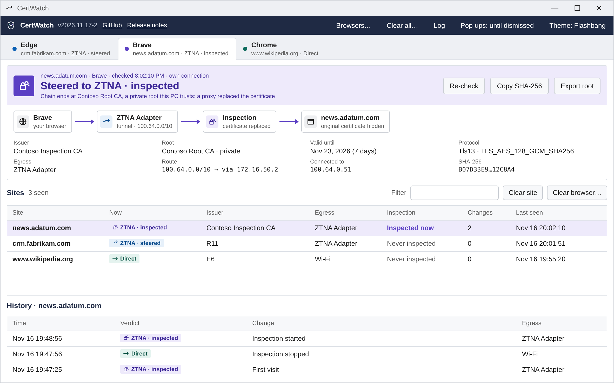
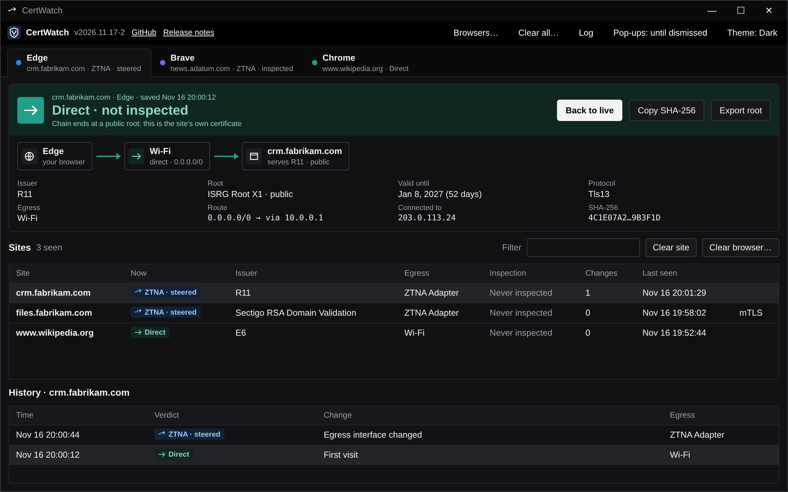

# CertWatch


**[GitHub](https://github.com/darthrater78/certwatch)** · **[Release notes for v2026.11.17-2](https://github.com/darthrater78/certwatch/releases/tag/v2026.11.17-2)** · [Changelog](CHANGELOG.md)

A Windows app for ZTNA demos. For each browser you choose to monitor, it shows, live, whether the
site in the active tab is **steered into the ZTNA tunnel** and whether its certificate was
**replaced for inspection**, with the path drawn out (browser → tunnel or direct → inspection →
site). It calls out changes in pop-ups, flags mTLS sites, and keeps an encrypted per-site history.

## How it works: it watches, it never intercepts

> [!IMPORTANT]
> **CertWatch is not in the browser's path.** It doesn't proxy, decrypt, capture or alter any
> browser traffic. The browser's own connections never pass through CertWatch, and it can't see
> what they contain.

What CertWatch actually does, in order:

1. **You choose which browsers to monitor.** Nothing is read until you pick browsers (CertWatch
   asks on first run; change it later with **Browsers…**). Browsers you didn't pick are never read.
2. **It reads the address bar.** For each ticked browser it reads the address shown in the active
   tab, through Windows UI Automation, the accessibility interface screen readers use. It only reads
   the text. It never types into, clicks or controls the browser, and needs no extension.
3. **It keeps only the host and port.** `https://portal.contoso.com/login?token=…` becomes
   `portal.contoso.com:443`. The path and query string are dropped before anything is checked,
   saved or logged. Non-HTTPS pages (`edge://`, `about:`, plain `http`) are ignored.
4. **It makes its own, separate connection to that host.** It starts a TLS handshake from
   CertWatch itself (through the system proxy if one is set), records the certificate the network
   hands back, and closes the connection. It sends no request, no cookies and no client
   certificate. It repeats this when the site changes and every 15 seconds after that.
5. **It works out the verdict.** The certificate chain says whether the site's own certificate
   arrived (public root) or a replacement did (a private root this PC trusts means inspection).
   Windows' routing table says which adapter the traffic leaves by: the ZTNA tunnel or the normal
   network.

**What it doesn't see.** Because it reads the address bar rather than the network, CertWatch knows
only the site in the active tab of each monitored browser. It doesn't see other tabs, the other
hosts a page loads from (CDNs, APIs, iframes), DNS lookups, or anything that never appears in the
address bar. If `portal.contoso.com` pulls data from `api.contoso.net`, only the portal is checked.

**Its view can differ from the browser's.** The verdict describes CertWatch's own connection, not
the browser's. Both normally take the same path (same adapter, same proxy), so they match. They can
differ when a ZTNA product treats traffic per browser rather than per device. An enterprise browser
with ZTNA built in is the main example: its in-browser path may be inspected or steered in a way a
separate connection from another app doesn't see.

**What it never does.** It listens on no network port, installs no certificate, changes no proxy,
PAC, route or registry setting, injects nothing into any process, hooks no keyboard input, and never
starts or drives a browser. The details, checkable against the code, are under
[Security architecture](#security-architecture).

## Screenshots

These are illustrations drawn from the app's own theme colours and layout, with invented example
data (Contoso, Fabrikam and Adatum are fictitious names), not captures of a real session. They are
drawn by `tools/gen_mockups.py` (see [Build](#build-linux-or-windows)).

**Choosing browsers.** On first run, and from **Browsers…** in the header, CertWatch asks which
browsers to monitor. Tick as many as you like; nothing changes until you press **Monitor**. Every
chosen browser gets a tab: here Firefox was chosen but isn't running, so its tab says so.


**Steered to ZTNA, not inspected (Dark).** Edge on `crm.fabrikam.com`: traffic leaves through the
ZTNA adapter's tunnel, and the chain ends at a public root, so the certificate is the site's
own. The path reads Edge → ZTNA Adapter → site, and the facts show the route and the IP
actually connected to.


**Steered and inspected (Flashbang).** Brave on `news.adatum.com`: the certificate was replaced by
an inspection CA chaining to a private root this PC trusts, so the card turns violet and adds the
inspection step to the path. (When CertWatch recognises the inspecting vendor, it names it.)



**Pop-ups.** CertWatch's own cards in the corner of the screen when a site is steered, inspection
is found, or traffic moves. Do not disturb doesn't hide them, so the audience sees them during a
screen share.


**History of a site.** Clicking a history entry shows that saved result on the card. Here
`crm.fabrikam.com` was first seen direct over Wi-Fi, then moved into the tunnel when the ZTNA policy
changed. **Back to live** returns to the current result.



**The log.** Every check, change and pop-up, with **Debug detail** for address-bar reads (the
host checked, never the full address), routes and issuers.


## Run (on Windows)

Run `CertWatch.exe`. Only one copy runs; starting it again brings the window forward. On first run
it monitors nothing and asks which browsers to watch: tick as many as you like (Edge, Chrome, Brave,
Island, Vivaldi, Opera, Firefox) and press **Monitor**. Change it any time with **Browsers…** in the
header. Your choice is saved. Each chosen browser gets a tab straight away, running or not (a closed
browser's tab says **Not running** and still shows its history), and each follows its own browser,
even in the background. Dropping a browser in
**Browsers…** stops reading its address bar right away and removes its tab. Its history is kept and
comes back if you pick it again. Browsers you didn't pick are never read. Each tab header shows that
browser's current site and verdict.

In a tab:

- **The card** shows the live verdict for the active site: the path diagram, issuer, root, validity,
  protocol, egress adapter, route, the IP CertWatch connected to, and the SHA-256 fingerprint.
  **Re-check**, **Copy SHA-256** and **Export root…** (the root as `.cer`/`.pem`, or the full chain)
  are on it.
- **Sites** lists every site seen in that browser once, with its current label, issuer, egress, and
  whether it was **inspected earlier** even if it isn't now. Filter it by name.
- **History** shows the selected site's first visit and every change. **Click a site or a history
  entry** to show that saved result on the card; **Back to live** returns.
- **Clear site** clears one site for that browser; **Clear browser…** clears all of that browser's
  history.

In the header: **GitHub** and **Release notes** links, **Browsers…** (which browsers to monitor),
**Clear all…** (every browser's history and the log), **Log**, **Pop-ups** (how long pop-ups stay) and **Theme** (Flashbang, the bright theme,
or Dark; the first run matches Windows). The **Log** window has **Debug detail**
(address-bar reads as the host checked, never the full address; routes and issuers) and **Write log to file** (off by default), plus Open log
folder, Copy all and Clear log.

Closing the window keeps CertWatch in the tray (the icon takes the latest verdict's colour); exit
from the tray menu, which also has **Show test pop-up**.

Pop-ups are CertWatch's own small cards in the bottom-right corner, not Windows notifications, so
Do not disturb (which Windows often turns on while you share your screen) doesn't hide them. By
default they stay until you dismiss them (✕) or click them; a click opens CertWatch on that
browser's tab with the site selected, so its card and history are right there. **Pop-ups** in the
header switches between until dismissed, 10 s, 30 s and 1 min; a timed pop-up waits while the mouse
is over it.

Optional command-line switches:

```
CertWatch.exe --browser island                  # monitor Island this run (not saved), tab shown before it starts
CertWatch.exe --process SomeBrowser.exe         # add a tab for a browser not in the built-in list
CertWatch.exe --interval 10                     # re-check each current site every 10 s (default 15)
```

## How it decides

Two independent measurements, combined into one label per site:

- **Inspection:** if the certificate chains to a public root (Mozilla bundle, matched by key so
  cross-signed roots count) or is publicly logged (Certificate Transparency), it's the site's own:
  **not inspected**. If it chains to a private root this machine trusts, a proxy replaced it:
  **inspected** (vendor named when recognised).
- **Steering (egress):** Windows is asked which route and interface reach the site's IP. A /32 host
  route with no gateway, a specific route through a gateway on an adapter that has no default
  gateway (how Island Private Access does it), a tunnel interface, or a known ZTNA/VPN adapter means
  **tunnelled to ZTNA**; otherwise **direct**. The adapter's friendly name is shown.

Labels: **Steered to ZTNA · inspected**, **Steered to ZTNA · not inspected**, **Inspected on this
device** (certificate replaced, traffic not tunnelled), **Direct · not inspected**. Sites inspected
earlier stay marked "Was inspected". Servers that ask for a client certificate are flagged **mTLS**;
a steered mTLS site that isn't inspected reads **Steered to ZTNA · not inspected (mTLS: needs
bypass)**, because an inspecting proxy can't present your client certificate. Servers that ask for
one only later in the connection (TLS 1.3 post-handshake authentication) aren't detected.

**Certificate pinning isn't detected, by design.** Pinning is a check inside the client, not
something a server shows, so no outside connection can see it. In browsers it doesn't block
inspection: dynamic pinning (HPKP) was removed in 2018, and Chrome and Edge skip their built-in pins
for certificates from a locally installed root, which is what inspecting proxies use. A browser site
that isn't inspected is bypassed by a rule, not by pinning. Desktop apps that pin (and fail when
inspected) aren't browsers, so CertWatch doesn't follow them.

The check is CertWatch's own connection from this machine, along the same route the browser's
traffic takes. A browser that routes or inspects its own traffic differently (for example, through
its own built-in proxy) may see something else.

## Security architecture

How CertWatch is built with regard to security, in statements you can check against the code.

### Design

- **Observe only, never intercept.** CertWatch sits beside the browser, not in its path. It listens
  on no port, installs no certificate, changes no proxy, PAC or route setting, injects nothing into
  any process, hooks no keyboard input, and never starts, drives or types into a browser. The
  browser's own traffic never passes through CertWatch.
- **What it reads.** The active tab's address comes from the browser's address bar through Windows
  UI Automation (read-only: it reads the bar's value and never sets it, clicks or sends keys), and
  only for the browsers you ticked under **Browsers…**; nothing is monitored until you choose. Only
  the host and port are kept: the path and query string are dropped before anything is checked,
  saved or logged. Site certificates come from CertWatch's own TLS connection to that
  site. Routes come from Windows' routing table (`GetBestRoute2`). All of it is treated as
  untrusted data: addresses are parsed and only `https` hosts are checked, and pop-up text is shown
  as plain strings, never as markup.
- **What it trusts.** Nothing it observes. CertWatch's own TLS connection accepts any certificate
  on purpose, because its job is to record what was presented. It sends no application data over
  that connection, and it requires TLS 1.2 or 1.3. Verdicts compare the chain against the bundled
  Mozilla root list (`src/CertWatch.Core/Resources/public-roots.pem`, from curl.se), matched by
  public key, and against Certificate Transparency proofs.
- **Privileges.** Runs as the signed-in user (`asInvoker`), never elevated. It writes only under
  `%LOCALAPPDATA%\CertWatch` (plus an exported root, wherever you choose to save it), and nothing
  to the registry; it reads one registry value, your Windows light/dark setting, on first run. P/Invoke calls load system DLLs from
  System32 only.
- **What it stores, and how it's protected (encryption at rest).**
  - `history.db`: sites visited per browser, with IPs, certificate details and egress. Everything
    that identifies a site or connection is encrypted with **AES-256-GCM**. Rows are found by an
    HMAC-SHA256 of the site, so site names aren't stored in the clear. Only timestamps, the browser
    name, the verdict, the change type, the mTLS flag and the egress kind are plain. SQLite
    `secure_delete` is on, and clearing history also truncates the write-ahead log.
  - `history.key`: the random 32-byte master key for the above, protected with **Windows DPAPI**
    under the current user's account, so only that account on that PC can unwrap it. History that
    can't be decrypted (for example, copied from another account) is set aside and a fresh database
    started.
  - `window.json`, `settings.json`: window position, theme, pop-up duration and log options, plain
    (not sensitive).
  - `crash.log`: written only if CertWatch hits an unexpected error. Plain text: the error and where
    it happened, which can include a site's name. Capped at 1 MB; delete it any time.
  - `logs\certwatch-<date>.log`: written **only** when you turn on **Write log to file**. Plain text,
    and it names the sites you visit, so it's off by default; **Clear log** and **Clear all**
    delete these files. Without it, the log lives only in memory (last 5,000 entries).
- **Network exposure.** CertWatch listens on nothing. Outbound, it makes one TLS handshake per site
  you visit, through the system proxy when one is set. It never starts or controls a browser.
- **Dependencies and releases.** NuGet packages are pinned and audited at every security gate
  (`dotnet list package --vulnerable --include-transitive`), and Dependabot watches them. The
  project stays on the .NET 10 LTS line, and the self-contained build pins the newest .NET security
  patch (`RuntimePatch` in `CertWatch.App.csproj`). The Mozilla root bundle is refreshed from
  curl.se by hand; check its date before each release. `CertWatch.exe` is not code-signed yet
  (accepted for an internal demo tool, 2026-11-16), but every release carries a signed **build
  provenance** attestation: `gh attestation verify CertWatch-v<version>-win-x64.exe --repo
  darthrater78/certwatch` proves the exe was built by the release workflow from the tagged commit.
  Pull requests that add a package with a High or Critical advisory fail **dependency review**, and
  GitHub **push protection** blocks pushes that contain secrets.

### Changes

- 2026-11-17: Browsers are monitored only once you tick them (**Browsers…**); nothing is read on first
  run. Debug logging now records only the host checked, not the full address-bar text, which could
  include paths and query strings (sign-in tokens, for example). Security pass: confirmed CertWatch
  listens on nothing, changes no system or browser setting, and only reads the address bar.
- 2026-11-17: Releases get a build provenance attestation; pull requests that change packages run
  dependency review. `crash.log` (plain text, written only on a crash) is listed above; keeping it
  readable was a deliberate choice, since the full error message is what makes a crash fixable.
- 2026-11-16: Added the log. It's in memory by default; writing it to disk is opt-in, and "Clear
  all" deletes it along with all history.
- 2026-11-16: History is encrypted at rest (AES-256-GCM, key protected by DPAPI). Plaintext history
  from earlier builds is migrated and the old pages are wiped.
- 2026-11-16: Removed Launch for demo. CertWatch no longer starts a browser or talks to one over
  DevTools, so that whole channel (and the separate browser profile it kept) is gone.
- 2026-11-16: Alerts are CertWatch's own pop-up windows instead of Windows notifications. They
  show text as plain text, take no input other than a click (which opens that site in CertWatch) or
  ✕, and never take focus.
- 2026-11-16: Notifications use Windows' built-in API instead of an unmaintained package
  (Microsoft.Toolkit.Uwp.Notifications, last released 2022).
- 2026-11-16: The tray icon and notifications call Windows directly (`Shell_NotifyIcon`) instead of
  WinForms and the WinRT toast API. That drops ~50 MB of bundled code and the per-user
  `AppUserModelId` registry key earlier builds wrote.
- 2026-11-16: The self-contained build bundles .NET 10.0.15 (a security release) instead of
  10.0.14. Microsoft.Data.Sqlite moved from the .NET 11 (STS) line to 10.0.15 (LTS).
- 2026-11-16: CertWatch's own TLS connection now requires TLS 1.2+. P/Invoke is limited to System32.
  A browser path found in the registry was only used if it was that browser's own program file
  (that lookup was later removed with Launch for demo).

## Build (Linux or Windows)

```
scripts/build.sh test       # build the solution and run the tests
scripts/build.sh publish    # self-contained single-file win-x64 build → artifacts/CertWatch-v<version>-win-x64.exe
scripts/build.sh            # both
```

The WPF app compiles on Linux (via `EnableWindowsTargeting`) and must run on Windows. Core tests run
anywhere.

- `src/CertWatch.Core`: cross-platform. TLS check, verdict, egress, encrypted history.
- `src/CertWatch.App`: Windows-only WPF app. UI Automation tracking, window, themes, tray, pop-ups, log.
- `tests/CertWatch.Core.Tests`: xUnit, including a local TLS server (chain and mTLS).
- `tools/make_icon.py`, `tools/gen_theme.py`: regenerate the icon and the theme files from `DESIGN.md`.
- `tools/gen_mockups.py`: redraws the README mock-ups in `docs/screenshots/` with a headless Chromium
  (Playwright's `chrome-headless-shell`, or `CHROME=<path>`), using the `DESIGN.md` colours and the
  csproj version. Run it after a UI change: `python3 -I tools/gen_mockups.py`.

### CI and releases

- **CI** (`.github/workflows/ci.yml`) runs `scripts/build.sh` on every push and pull request, checks
  for vulnerable packages, and uploads the Windows exe itself, not zipped, as an artifact (kept 14
  days). Docs-only changes skip the build.
- **Release** (`.github/workflows/release.yml`) runs when a `v*` tag is pushed. It checks that the tag
  is on `main` (pre-release tags such as `-dev.1` excepted), that CI passed for that commit, and that
  the tag matches `<Version>` in `CertWatch.App.csproj`. It then builds the exe and publishes the
  GitHub release with the matching `CHANGELOG.md` section as notes. Pre-release tags publish as
  pre-releases.
- The release also attaches a signed **build provenance** attestation to the exe
  (`gh attestation verify`).
- **Dependency review** (`.github/workflows/dependency-review.yml`) fails a pull request that adds a
  package or action with a High or Critical advisory. It runs only when a project file or workflow
  changes.
- **Lint workflows** (`.github/workflows/lint-workflows.yml`) runs actionlint on workflow changes.
- Dependabot keeps the NuGet packages and the action pins current.
